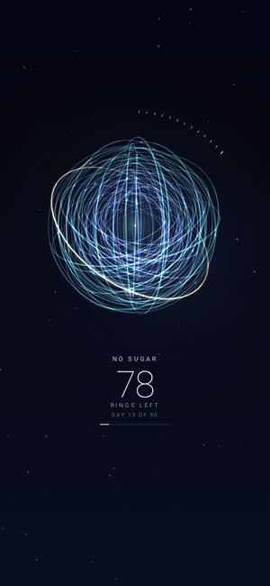
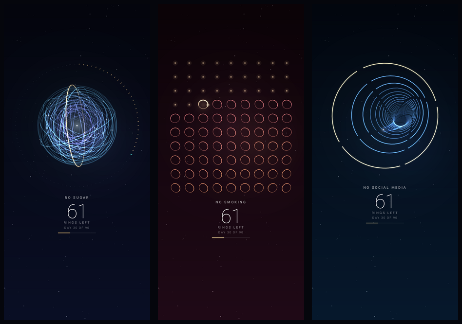
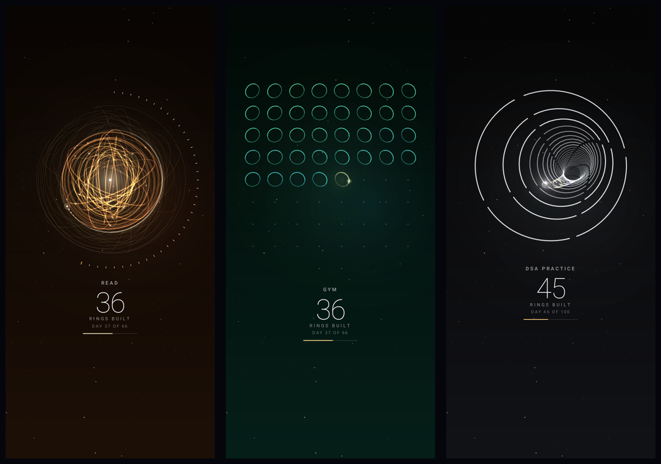

# Ringdown

**An Android live wallpaper that turns a habit into rings: one ring per day.**
Breaking a habit? The rings disappear one by one. Building one? They get built one by one.
You see your progress every time you look at your phone.

<p align="center"></p>

<p align="center"><b><a href="https://github.com/poshithNandyala/ringdown/raw/main/apk/Ringdown.apk">⬇ Download the APK (v1.1)</a></b> · Android 8.0 or newer</p>

## Why rings?

Habits run as loops in your brain: a cue, the routine, then the reward. Repeat a loop often enough and the
brain packs it into one automatic chunk. MIT researchers saw neurons in the striatum fire at the start and the
end of these chunks, like brackets around the habit (Martiros, Burgess & Graybiel, 2018). Ringdown draws that
loop as rings, one ring for each day.

- **Breaking a habit: watch the loop fade.** All rings start lit. Every day you stay away from the habit, one
  ring breaks. Pathways you stop using get weaker, and the brain can heal: in people who stayed off
  methamphetamine for 12 to 17 months, dopamine transporters partly recovered (Volkow et al., 2001). The old
  loop never vanishes completely, so cravings can still show up. That's normal. If you slip, restart.
- **Building a habit: watch the loop form.** Rings start as a faint blueprint. Every day you show up, one ring
  gets built. In a UCL study, a daily habit took a median of 66 days to feel automatic (anywhere from 18 to
  254 days), and missing a single day didn't undo the progress (Lally et al., 2010).
- **Why seeing it helps.** Monitoring progress makes people more likely to reach their goals, especially when
  the progress is recorded somewhere visible (Harkin et al., 2016, a meta-analysis of 138 studies). Your lock
  screen is the place you look most, often right when a craving or an excuse shows up.

## What it looks like

**Break a habit** (rings disappear)



**Build a habit** (rings get built)



## Features

- **Two modes:** Break a habit (countdown) or Build a habit (rings get added).
- **32 ready-made habits** (no sugar, no smoking, no social media, gym, reading, DSA practice, meditation...)
  or type your own name. Each comes with a sensible number of days.
- **Any length:** 1 to 365 days. Already on a streak? Enter how many days you've already done.
- **Three 3D styles:** Orb (a gyroscope of rings), Grid (a calendar of spinning rings), Tunnel (gates toward a light).
- **A reward every day:** today's ring charges up, then shatters into sparks (or gathers light and settles into
  place), the light flies into your progress dial, the counter rolls and you get a short message.
  Bigger moments on day 1, at 25/50/75% and on the last ring, with fireworks at the end.
- Six color themes, size and position sliders, optional haptic tick, battery saver.
- Tap the home screen and the rings react; double-tap to replay today's animation.
- "On my wallpaper" button plays the next day's animation on your real wallpaper right away.
- Built-in "How it works" guide with the research above.

## How to use

1. Download [`apk/Ringdown.apk`](https://github.com/poshithNandyala/ringdown/raw/main/apk/Ringdown.apk) on your phone and open it (allow "Install unknown apps" for your browser or file manager when Android asks).
2. Open Ringdown, choose **Break a habit** or **Build a habit**, pick a habit or name your own.
3. Set the number of days (1 ring = 1 day) and, if you're already on a streak, the days you've done.
4. Pick a style and color, tap **Set as wallpaper** and choose **Home and lock screen**.
5. Every midnight a day completes. The first time you look at your phone after that, a ring breaks (or gets
   built) and the count updates.
6. Slipped or missed a day? Tap **Restart**. One bad day doesn't define you.

> Ringdown is a motivation tool, not treatment. Stopping alcohol, some drugs or medicines suddenly can be
> dangerous, so talk to a doctor first. In India, Tele-MANAS (14416) offers free 24×7 mental health support.

## Build from source

No Gradle needed. Requires JDK 17+.

```bash
./build.sh            # -> out/apk/Ringdown.apk
```

`build.sh` finds the Android tools in this order: the env vars `SDK_JAR` / `AAPT2` / `R8_CP`, then
`$ANDROID_HOME` (platform 35 + newest build-tools), then a local `buildtools/` folder. A signing key is
created in `keystore/` on the first build. Keep it: Android only installs an update over an existing app
if both are signed with the same key.

### Project layout

| Path | What's there |
| --- | --- |
| `src/core` | The whole scene: 3D ring math, both modes, animations, particles, text. Pure Java, no Android. |
| `src/app` | Android: the wallpaper service, settings screen, guide, and a Canvas renderer that draws all lines as one GPU mesh (`drawVertices`). |
| `harness` | Desktop preview renderer (`Render`) and a fuzz test for the scene (`Fuzz`), used to check every frame before it ships. |
| `res`, `assets` | Icon, wallpaper metadata, bundled Roboto fonts. |

## Sources

- Lally, van Jaarsveld, Potts & Wardle (2010). How are habits formed: Modelling habit formation in the real
  world. *European Journal of Social Psychology*. [doi:10.1002/ejsp.674](https://doi.org/10.1002/ejsp.674)
- Martiros, Burgess & Graybiel (2018). Inversely active striatal projection neurons and interneurons
  selectively delimit useful behavioral sequences. *Current Biology*. [PMC5820126](https://pmc.ncbi.nlm.nih.gov/articles/PMC5820126)
- Volkow et al. (2001). Loss of dopamine transporters in methamphetamine abusers recovers with protracted
  abstinence. *Journal of Neuroscience* 21(23). [doi:10.1523/JNEUROSCI.21-23-09414.2001](https://doi.org/10.1523/JNEUROSCI.21-23-09414.2001)
- Harkin et al. (2016). Does monitoring goal progress promote goal attainment? A meta-analysis of the
  experimental evidence. *Psychological Bulletin* 142(2). [doi:10.1037/bul0000025](https://doi.org/10.1037/bul0000025)

## License

Code: MIT (see `LICENSE`). Roboto fonts in `assets/fonts`: © Google, Apache License 2.0 (`assets/fonts/LICENSE-Roboto.txt`).
